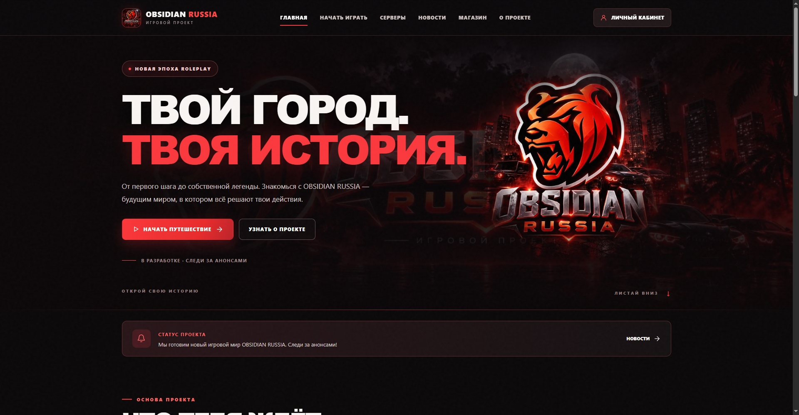
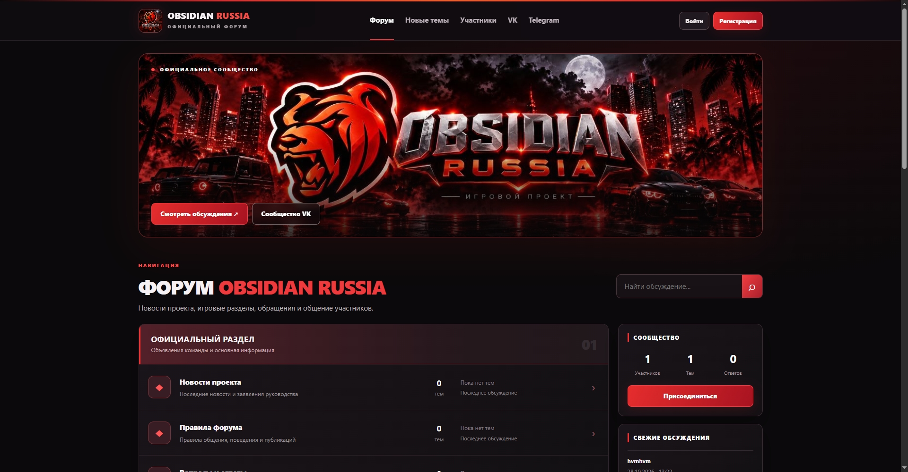
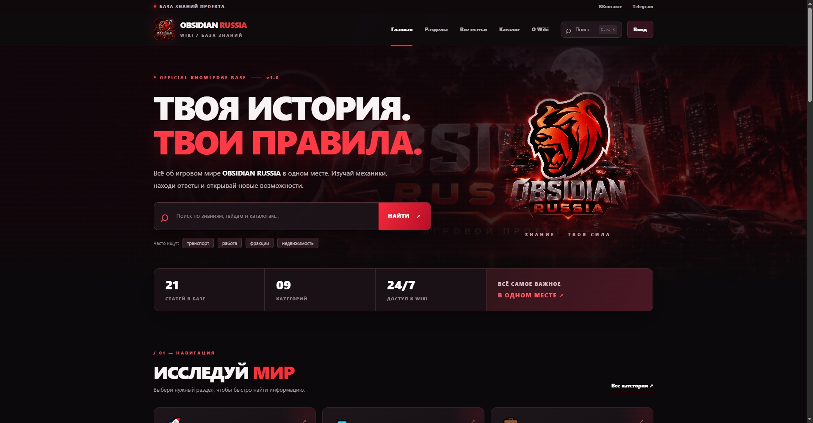

<p align="center">
  
</p>

<h1 align="center">OBSIDIAN RUSSIA</h1>

<p align="center">
  <strong>Твоя история. Твои правила.</strong><br>
  Независимый RolePlay-проект: сайт, форум, база знаний и материалы игрового мира.
</p>

<p align="center">
  <a href="https://github.com/Zeihos/Obsidian-Russia/actions/workflows/smoke.yml"></a>
  
  
  
</p>

<p align="center">
  <a href="#компоненты">Компоненты</a> ·
  <a href="#быстрый-старт">Запуск</a> ·
  <a href="#состояние-проекта">Готовность</a> ·
  <a href="#документация">Документация</a> ·
  <a href="#сообщество">Сообщество</a>
</p>

---

> [!IMPORTANT]
> **OBSIDIAN RUSSIA находится в разработке.** Сайт, форум и Wiki запускаются локально, но это **не публичный релиз игрового сервера**. Реальные платежи, автоматический игровой онлайн и проверенная сборка мода пока отсутствуют.

## О проекте

**OBSIDIAN RUSSIA** — самостоятельный игровой RolePlay-проект с собственным красно-чёрным оформлением. Этот репозиторий объединяет веб-инфраструктуру проекта: сайт с аккаунтами и новостями, форум для общения и обращений, Wiki с игровыми справочниками и материалы оформления.

Проект не является официальным репозиторием **BLACK RUSSIA** и не представляет её разработчиков.

## Компоненты

<table>
  <tr>
    <td align="center" width="33%">
      <a href="docs/previews/site-rc.jpg"></a><br>
      <strong>ОСНОВНОЙ САЙТ</strong><br>
      <sub>Новости · аккаунты · серверы · поддержка</sub><br>
      <a href="Сайт/">Исходный код →</a>
    </td>
    <td align="center" width="33%">
      <a href="docs/previews/forum-rc.jpg"></a><br>
      <strong>ФОРУМ</strong><br>
      <sub>Темы · ответы · жалобы · модерация</sub><br>
      <a href="Форум/">Исходный код →</a>
    </td>
    <td align="center" width="33%">
      <a href="docs/previews/wiki-rc.jpg"></a><br>
      <strong>WIKI</strong><br>
      <sub>Статьи · поиск · каталоги · редактор</sub><br>
      <a href="Вики/">Исходный код →</a>
    </td>
  </tr>
</table>

### Что уже реализовано

- **Сайт:** регистрация и вход, личный кабинет, новости, справочник серверов, поддержка, административные функции.
- **Форум:** разделы, темы, ответы, поиск, подписки, жалобы, роли и инструменты модерации.
- **Wiki:** статьи, редактор с версиями, категории, поиск и каталоги игровых объектов.
- **Единый вход:** переход с аккаунта сайта на форум через одноразовый код; старые форумные профили не объединяются автоматически.
- **Техническая основа:** SQLite, резервные копии, тесты HTTP/SSO и GitHub Actions на Windows и Linux.

## Быстрый старт

**Требуется:** Python **3.12 или новее**. Для локального запуска сторонние Python-пакеты не нужны.

Перед запуском можно проверить окружение командой `python dev.py doctor`: она покажет, доступны ли основные файлы и свободны ли порты **8080, 8090 и 8100**. Диагностика не изменяет базы данных.

<details open>
<summary><strong>Windows — самый простой способ</strong></summary>

1. [Скачайте репозиторий](https://github.com/Zeihos/Obsidian-Russia/archive/refs/heads/main.zip) или клонируйте его.
2. Распакуйте файлы и откройте папку проекта.
3. Запустите **<code>start-all.bat</code>**.
4. Откройте нужный локальный адрес из таблицы ниже.

</details>

<details>
<summary><strong>Запуск через терминал (Windows / Linux / macOS)</strong></summary>

```bash
git clone https://github.com/Zeihos/Obsidian-Russia.git
cd Obsidian-Russia
python dev.py run
```

На Linux/macOS вместо `python` при необходимости используйте `python3`. Для остановки нажмите `Ctrl+C`.

</details>

| Веб-сервис | Локальный адрес | Панель управления |
| --- | --- | --- |
| Основной сайт | http://localhost:8080 | http://localhost:8080/admin |
| Форум | http://localhost:8090 | http://localhost:8090/admin |
| Wiki | http://localhost:8100 | http://localhost:8100/admin |

Локальные базы автоматически создаются в **`.runtime/`**. Они не публикуются в Git. Если ранее использовались отдельные каталоги `data/`, они **не мигрируют автоматически**.

### Администрирование

Создать администратора каждого сервиса:

```bash
python dev.py admin site
python dev.py admin forum
python dev.py admin wiki
```

Резервное копирование:

```bash
python dev.py backup site
python dev.py backup forum
python dev.py backup wiki
```

> [!NOTE]
> Администраторы сайта, форума и Wiki создаются отдельно. Единый вход сейчас связывает только **сайт → форум**. Wiki сохраняет собственные права редакторов.

## Состояние проекта

| Подсистема | Состояние |
| --- | --- |
| Основной сайт, форум и Wiki | ✅ Работают локально, есть автоматические проверки |
| Единый вход сайта и форума | ✅ Локальный сценарий протестирован |
| Публикация в интернет с HTTPS | 🛠 Требует настройки и проверки безопасности |
| Объединение существующих аккаунтов | 🛠 Пока не реализовано |
| Игровой сервер и мод | ⏳ Архив сохранён, работоспособность не подтверждена |
| Реальный онлайн серверов | ⏳ Интеграция не подключена |
| Платежи и донат | ⏳ Реальные платежи не принимаются |

Следующие этапы описаны в **[плане развития](docs/ROADMAP.md)**. Скриншоты выше — предпросмотры интерфейсов, а не подтверждение развёрнутого публичного сервиса.

## Структура репозитория

```text
Obsidian-Russia/
├── Сайт/               основной веб-портал
├── Форум/              разделы, темы и модерация
├── Вики/               статьи и каталоги
├── design/             фирменная графика и публикации
├── game/legacy/        исходный, пока не проверенный игровой архив
├── docs/               инструкции, план развития и скриншоты
├── tests/              тесты приложений и чистоты репозитория
├── .github/            автоматические проверки и шаблоны
├── dev.py              общий запуск и обслуживание сервисов
├── start-all.bat       быстрый запуск на Windows
└── start-all.sh        запуск на Linux/macOS
```

## Документация

| Раздел | Что внутри |
| --- | --- |
| [Развёртывание](docs/DEPLOYMENT.md) | HTTPS, порты, резервное копирование, переменные окружения |
| [Единый вход (SSO)](docs/SSO.md) | Авторизация сайта и форума, ограничения, секреты |
| [План развития](docs/ROADMAP.md) | Что готово и что осталось перед релизом |
| [Безопасность](SECURITY.md) | Известные риски и сообщения об уязвимостях |
| [Участие в проекте](CONTRIBUTING.md) | Правила предложений, ошибок и Pull Request |
| [Дизайн](design/README.md) | Логотип, обложка и материалы сообществ |
| [Игровые материалы](game/README.md) | Статус архивной сборки |

Проверить проект локально:

```bash
python -m unittest discover -s tests -p "test_*.py" -v
```

## Безопасность и использование кода

> [!WARNING]
> В старых коммитах публичного репозитория находились SQLite-базы. Они исключены из текущей версии, **но могут оставаться доступными в истории Git**. При наличии реальных аккаунтов нужно отозвать сессии, сменить затронутые пароли и отдельно решить вопрос очистки истории.

Публичная доступность исходников **не означает автоматического разрешения на их копирование или перераспространение**. Лицензия для репозитория пока не указана; условия использования необходимо согласовать с владельцем. У сторонних компонентов могут быть собственные правообладатели.

## Сообщество

<p align="center">
  <a href="https://vk.ru/obsidian_brussia"><strong>ВКонтакте</strong></a>
  &nbsp;&nbsp;·&nbsp;&nbsp;
  <a href="https://t.me/obsidian_brussia"><strong>Telegram</strong></a>
  &nbsp;&nbsp;·&nbsp;&nbsp;
  <a href="https://github.com/Zeihos/Obsidian-Russia/issues"><strong>Ошибки и предложения</strong></a>
</p>

<p align="center"><sub>© OBSIDIAN RUSSIA · Независимый игровой проект · Разработка продолжается</sub></p>
